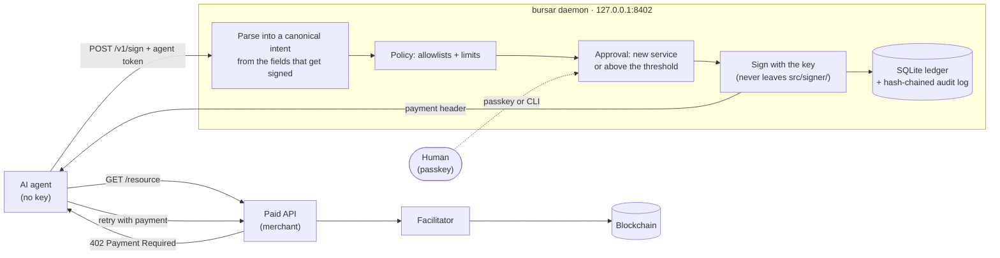
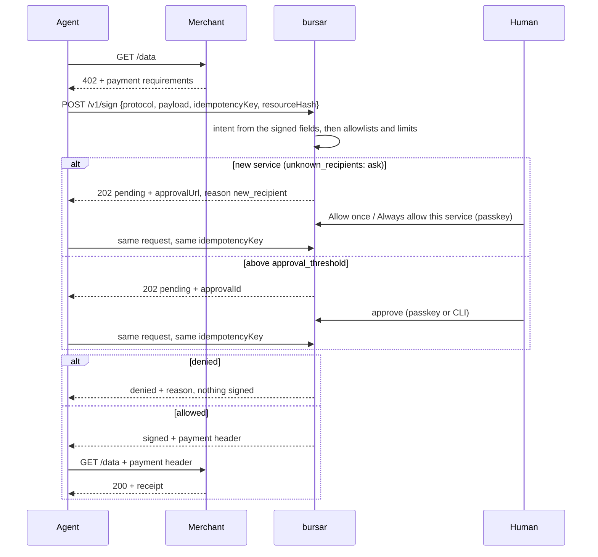

# bursar

> [!WARNING]
> bursar is experimental. It has not been audited and has not yet been used with real money. Use it at your own risk, and only with amounts you can afford to lose.

Minimal local wallet for AI agents with spending limits, allowlists & passkey approvals.

- The key never reaches the agent: a separate OS user, and no endpoint that signs arbitrary bytes
- Minimal: 5 runtime dependencies, cryptography from audited [noble](https://paulmillr.com/noble/)
- x402 (EVM & Solana) and raw ERC-20 transfers; MPP is checked against the policy, but its Tempo signer is not ready yet
- Per-tx, daily, monthly, per-recipient, per-task, wallet & velocity limits in plain YAML
- Human approval with Touch ID and other passkeys
- MCP server for Claude Code and other agents

## Install (macOS, Linux, Windows)

```sh
npm ci && npm run setup
```

A few questions (network, limits, approval threshold), then setup installs the daemon under its own system account, registers your passkey (Touch ID, Windows Hello, a security key or a phone) and connects Claude Code. On Linux it needs systemd; on Windows run it from a terminal opened with "Run as administrator". Details and the manual path: [SETUP_GUIDE.md](SETUP_GUIDE.md).

## How it works

bursar is a local daemon that holds a wallet key and signs payments on behalf of AI agents. An agent sends it a payment request (an x402 `402` response, an MPP challenge, or a raw EVM token transfer). bursar turns that into a canonical intent built from the fields that will actually be signed, checks it against a YAML policy (allowlists, per-tx / per-day / per-recipient / velocity limits, approval threshold), and only then signs. The agent never sees the key.





## Threat model

**Protects against**

- A prompt-injected or buggy agent spending more than the policy allows: per-transaction, per-day (calendar UTC or rolling 24h), per-recipient-per-day and velocity limits, counted in a SQLite ledger that survives restarts.
- Paying anyone, on any chain, in any token outside the allowlist. A recipient can be pinned to specific chains.
- Payloads that say one thing and sign another. Recipient and amount always come from the exact fields that get signed (`payTo` / `amount` for x402, decoded calldata for EVM). Agent-supplied extras like `recipient` or `amount` are ignored, and any display amount (`price`, `displayAmount`) that disagrees with the signed amount gets the request rejected. The signer checks the intent against the plan again before signing.
- Signing arbitrary bytes. There is no endpoint for messages, typed data or raw transactions. EVM transactions are accepted only for whitelisted selectors (`transfer`, `transferWithAuthorization`), with zero native value and a cap on the network fee.
- Double spending through retries. Idempotency keys are scoped per agent. The same key returns the same result and is charged once, and the same key with a different payload returns `409`.
- Races. Each decide-sign-record step runs in a `BEGIN IMMEDIATE` transaction, so even two daemons sharing one ledger file cannot both pass the daily limit.
- Paying for a different resource than the one requested. With `resource` + `resourceHash`, bursar recomputes the hash and checks it against the URL in the 402 payment requirements. For MPP the hash becomes the TIP-20 memo.
- Key exposure through the process boundary. The key is loaded only in `src/signer/keystore.ts` (from a `chmod 600` file owned by the daemon user, ACL-locked on Windows, or from an env var that is deleted after reading). It lives only inside the signer closure and is zeroed on shutdown. The HTTP server binds to loopback, rejects non-loopback `Host` headers (DNS rebinding), and requires a bearer token per agent.
- Silent tampering with history. The audit log is append-only JSONL, and each entry carries the sha256 of the previous line.

**Does not protect against**

- An attacker with code execution as the daemon user, or with root. They can read the keyfile or process memory. JS strings cannot be zeroed, so a key that came through `BURSAR_KEY` may stay in memory as a string.
- A merchant that takes the money and doesn't deliver. bursar limits how much can be lost, not whether the service is honest.
- Network fees on Tempo when the merchant does not sponsor them (`feePayer: false`) are refused by default. When `tempo.allow_client_paid_fees` is on, bursar picks the gas limit and fee itself (not the agent), caps the worst case at `tempo.max_fee_usd`, and counts it in USD against `per_tx`, `per_day` and the approval threshold. Tempo prices gas in attodollars, so the fee is already in dollars. EVM gas (in ETH) is only capped by `evm.max_network_fee_wei` and not counted in the USD budget.
- Non-stablecoin and depeg risk. USD limits count 1 token unit as 1 USD (`stablecoinUnitsToMicroUsd`), so they are only correct for USD-pegged stablecoins and only while the peg holds. bursar never prices anything: a token outside the allowlist is refused, and the policy loader rejects `native` (ETH, SOL) in `allow.assets`. Allowlisting a non-stablecoin token makes every limit wrong, so don't.
- Spending that agents share, unless you set `limits.wallet_per_day`. Every other limit applies per agent, so without it two agents on the same wallet can each spend their own daily limit.
- An agent with shell access as the operator. With `approval_threshold.method: cli` it could run `bursar approve` itself. Use `method: passkey`: approving then needs a WebAuthn assertion with user presence (and by default user verification) from an authenticator the agent does not hold, and `bursar approve` refuses. Registering a passkey happens only through `bursar passkey add`, on a one-time secret URL printed to the operator's terminal, never over the daemon's API.
- A compromised agent token. Whoever holds it can spend that agent's budget, within policy.
- A malicious RPC endpoint. EVM simulation and Solana blockhash lookup trust the configured RPC.

## Quickstart

Requires Node.js 22.18+ (built-in `node:sqlite`, native TypeScript stripping for `npm run dev`).

```sh
npm ci
npm run build
npm test

node dist/src/index.js keygen --out ~/.bursar/key
export BURSAR_TOKEN_NANOCODE="$(openssl rand -hex 32)"
npm run dev -- serve --policy policy.example.yaml

node dist/src/index.js address --policy policy.example.yaml
```

Fund the printed addresses with USDC. Then from the agent:

```sh
curl -s -H "Authorization: Bearer $BURSAR_TOKEN_NANOCODE" http://127.0.0.1:8402/v1/budget
python3 examples/nanocode-tool.py https://paid-api.example.com/v1/data
```

Payments above `approval_threshold` return `pending`. A human resolves them, and the agent's next retry with the same idempotency key completes. With `method: cli` (default) that happens from the terminal:

```sh
node dist/src/index.js approvals --policy policy.example.yaml
node dist/src/index.js approve apr_... --policy policy.example.yaml
node dist/src/index.js deny apr_... --policy policy.example.yaml
```

With `method: passkey`, register a passkey once (Touch ID, Windows Hello, a security key or a phone):

```sh
node dist/src/index.js passkey add --policy policy.example.yaml --name laptop
node dist/src/index.js passkey list --policy policy.example.yaml
```

Pending responses then carry `approvalUrl` (`http://localhost:8402/approve/apr_...`). Open it, check the recipient and amount, and confirm with the passkey. The page must be opened on `localhost`, not `127.0.0.1`, because WebAuthn does not allow IP addresses as the relying party. The challenge the passkey signs covers the approval id, the decision and the hash of the intent, so a signature for one approval cannot approve another. The CLI can still deny, but it can no longer approve.

With passkey approvals you can also skip writing merchant addresses into the policy. Set `allow.unknown_recipients: ask`, and the first payment to a recipient that is not on the list returns `pending` with `reason: "new_recipient"`. The approval page shows the service (the host of the paid resource), the recipient and the amount, and offers **Allow once**, **Always allow this service** or **Deny**. "Always allow" stores the recipient for that one chain, and later payments to it still follow every limit and the approval threshold. The passkey signs a separate challenge for "always allow", so a signature for "allow once" cannot be replayed to add a recipient. Chains and tokens still come only from the policy file. List and remove learned recipients from the CLI:

```sh
node dist/src/index.js recipients --policy policy.example.yaml
node dist/src/index.js recipients remove 0x... --policy policy.example.yaml
```

Give each piece of work its own budget with a task. The harness that starts the agent opens it (not the model) and passes the `taskId` to the payment tool, so a prompt-injected agent cannot raise its own ceiling:

```python
task = open_task(budget_usd="5.00", ttl_seconds=3600, label="fix flaky test")
pay("https://paid-api.example.com/v1/data", task_id=task)
```

Review what was spent:

```sh
node dist/src/index.js report --policy policy.example.yaml               # this month (UTC)
node dist/src/index.js report --policy policy.example.yaml --period day
node dist/src/index.js report --policy policy.example.yaml --since 2026-11-01 --until 2026-11-08 --json
```

The report shows spend and network fees by agent, recipient and task, denials by reason, approvals resolved and still pending, and whether the audit log's hash chain is intact.

The ledger (`bursar.db`) and the audit log (`bursar.audit.jsonl`) are created next to the policy file, unless `state.dir` says otherwise.

## Local sandbox

`npm run sandbox` runs the whole flow on this machine with no network and no real money:

- `sandbox/merchant.ts` is a fake paid API. It answers with real `402`s (x402 v1/v2 on Base, x402 on Solana, MPP/Tempo) and checks every payment as a facilitator would: it recovers the EIP-712 signer, verifies the Solana ed25519 signature and `transferChecked`, rejects replayed nonces and tracks balances. The same server stubs the JSON-RPC calls bursar makes (`eth_call`, `eth_gasPrice`, `getLatestBlockhash`).
- `sandbox/policy.yaml` is a policy for two agents sharing one wallet. Keys and tokens are generated per run, and state goes to a temp dir (`--keep` keeps it).
- `sandbox/agent.py` drives `examples/nanocode-tool.py` through 18 scenarios. The happy paths must be paid and verified by the merchant. Every attack and limit must be denied with the expected reason: an over-limit payment, a phishing `payTo`, a lying display amount, a 402 for a different resource, MPP fees, approve/deny by a human, a task budget, raw EVM `approve()`, and a second agent hitting the wallet cap.
- `sandbox/run.ts` starts everything, plays the human who approves $0.70 and denies $0.80, prints what the merchant actually received and `bursar report`, and exits non-zero if any scenario misbehaves.

bursar counts a payment as spent when it signs it, not when it settles. A signed authorization the agent never uses, like the raw EVM transfer in the sandbox, still uses up budget. That is why the merchant total is lower than bursar's.

`npm run sandbox:manual` starts the same fake merchant on `:8500` with keys and tokens kept in `sandbox/.local/env`, so you can run the daemon, play the agent (`sandbox/pay.py` or curl) and approve by hand in separate terminals.

## Real money

[SETUP_GUIDE.md](SETUP_GUIDE.md) walks through a safe install and a first purchase by Claude Code, on Base Sepolia first and then on Base mainnet:

- `scripts/install-macos.sh` installs bursar under a hidden `_bursar` user with a launchd daemon. The key, ledger and policy live in `/var/db/bursar` and the code in a root-owned `/opt/bursar`, so an agent running as you can neither read the key nor change the policy or the code. `scripts/uninstall-macos.sh` undoes it.
- `scripts/install-linux.sh` does the same with a `bursar` system user and a hardened systemd unit (`ProtectSystem=strict`, `NoNewPrivileges`, no capabilities). State lives in `/var/lib/bursar`, code in `/opt/bursar`. `scripts/uninstall-linux.sh` undoes it.
- `scripts/install-windows.ps1` runs the daemon as a Windows service under the virtual account `NT SERVICE\bursar` (no password, no logon). The key and policy in `%ProgramData%\bursar` are ACL-locked to that account (read-only), SYSTEM and Administrators; the code is in `%ProgramFiles%\bursar`. A small service host is compiled on the spot with the .NET Framework, so no third-party binary is downloaded. `scripts/uninstall-windows.ps1` undoes it.
- `src/mcp/server.ts` is an MCP server (`pay`, `budget`, `open_task`) for Claude Code and other MCP clients. It holds only the agent token: `claude mcp add bursar -e BURSAR_TOKEN=… -- node src/mcp/server.ts`.
- `examples/testnet-merchant` is a paid API built on Coinbase's `@x402/express` against the public x402.org facilitator on Base Sepolia, with its own dependencies. `npm run offline` there runs it against a local facilitator that checks the EIP-3009 signature without touching the chain.

## Policy reference

Unknown keys are rejected. `${VAR}` is substituted from the environment, and an unset variable is an error. Numbers must be plain decimals (`20`, `0.50`). Hex, octal, exponents, leading zeros and `.inf` are rejected rather than silently converted. Values are read from the source text, so large amounts keep full precision; quoting a number (`"100.50"`) works too.

| key                                                        | meaning                                                                                                                                                                                                                                                                 |
| ---------------------------------------------------------- | ----------------------------------------------------------------------------------------------------------------------------------------------------------------------------------------------------------------------------------------------------------------------- |
| `version`                                                  | must be `1`                                                                                                                                                                                                                                                             |
| `wallet.keyfile`                                           | path to the key file (`~` expanded, relative to the policy). Must be mode 600 and owned by the daemon user. Format: `evm: 0x<64 hex>` and/or `solana: <64 hex ed25519 seed>`, one per line                                                                              |
| `wallet.env`                                               | env var checked before the keyfile (default `BURSAR_KEY`), same format with `;` or newlines. Removed from `process.env` after reading                                                                                                                                   |
| `agents[].id`, `agents[].token`                            | agent identity and bearer token (24+ chars, unique). Only the sha256 of the token is kept in memory                                                                                                                                                                     |
| `limits.per_tx.usd`                                        | maximum per payment                                                                                                                                                                                                                                                     |
| `limits.per_day.usd`, `.window`                            | daily cap per agent; `calendar_utc` (resets 00:00 UTC) or `rolling_24h`                                                                                                                                                                                                 |
| `limits.velocity.max_tx`, `.per_seconds`                   | at most N signed payments per sliding window                                                                                                                                                                                                                            |
| `limits.per_recipient_day.usd`                             | default daily cap per recipient per agent                                                                                                                                                                                                                               |
| `limits.wallet_per_day.usd`                                | daily cap on the combined spend of all agents (same window as `per_day`); denial reason `wallet_per_day_limit`                                                                                                                                                          |
| `limits.per_month.usd`, `.window`                          | monthly cap per agent: `calendar_utc` (resets on the 1st, 00:00 UTC) or `rolling_30d`; denial reason `per_month_limit`                                                                                                                                                  |
| `limits.per_task.max_usd`, `.max_ttl_seconds`, `.required` | bounds for task budgets opened with `POST /v1/tasks` (defaults: `per_day.usd`, 86400, `false`). With `required: true` every payment must carry a `taskId` (`task_required`)                                                                                             |
| `limits.approval_threshold.usd`, `.timeout_seconds`        | above this amount the request is `pending` until approved; unresolved after the timeout (default 300s) it is denied                                                                                                                                                     |
| `limits.approval_threshold.method`                         | `cli` (default): `bursar approve`. `passkey`: a WebAuthn ES256 assertion on `/approve/<id>`; `bursar approve` refuses                                                                                                                                                   |
| `limits.approval_threshold.user_verification`              | `required` (default: biometric or PIN) or `preferred` (user presence alone is enough)                                                                                                                                                                                   |
| `allow.chains`                                             | CAIP-2 chain ids (`eip155:8453`, `solana:mainnet`, `eip155:4217` = Tempo mainnet; `eip155:42431` = Tempo testnet). x402 v1 names (`base`, `solana`) and Solana genesis-hash ids are mapped onto these                                                                   |
| `allow.assets`                                             | USD-pegged stablecoin addresses or mints only, each counted as 1 token = 1 USD; `native` is rejected. A string means 6 decimals on any allowed chain; an object `{address, decimals, chains, label}` is more precise                                                    |
| `allow.recipients`                                         | `[{address, label, max_usd_day, chains}]`. The address in `policy.example.yaml` is a placeholder: put the merchant's real `payTo` / `recipient` there, or the literal `any` to disable recipient checks. `max_usd_day` overrides `per_recipient_day` for that recipient |
| `allow.unknown_recipients`                                 | `deny` (default): unknown recipients are refused with `recipient_not_allowed`. `ask`: they go to a passkey page with "Allow once" / "Always allow this service" / "Deny". Needs `approval_threshold.method: passkey`, because an agent with a shell could drive the CLI |
| `require_resource_hash`                                    | deny payments that carry no `resourceHash` (default `false`)                                                                                                                                                                                                            |
| `evm.allowed_selectors`                                    | calldata selectors allowed for `protocol: evm` (default `transfer`, `transferWithAuthorization`). A selector bursar has no decoder for is still refused                                                                                                                 |
| `evm.simulate_before_sign`                                 | `eth_call` the transaction against `rpc[chain]` first; with no RPC configured the request is denied (default `true`)                                                                                                                                                    |
| `evm.max_network_fee_wei`                                  | cap on `gasLimit * maxFeePerGas` (default 0.001 ETH)                                                                                                                                                                                                                    |
| `tempo.allow_client_paid_fees`                             | allow MPP charges where the wallet pays the Tempo network fee (`methodDetails.feePayer` false or absent). Default `false`: such challenges are denied with `mpp_client_fees_not_allowed`                                                                                |
| `tempo.max_fee_usd`                                        | cap on the worst-case Tempo fee per payment, `ceil(gas_limit * max_fee_per_gas / 10^12)` micro-USD (default 0.01). The fee is charged to `per_tx`, `per_day` and the approval threshold, not to recipient limits                                                        |
| `tempo.gas_limit`                                          | gas limit bursar uses for client-paid Tempo payments (default 300000). `max_fee_per_gas` is 2x `eth_gasPrice` from `rpc['eip155:4217']`, clamped to the cap                                                                                                             |
| `rpc`                                                      | map of chain id to JSON-RPC URL, used for EVM simulation, Solana blockhashes and Tempo gas prices                                                                                                                                                                       |
| `server.host`, `.port`, `.allow_remote`                    | default `127.0.0.1:8402`; non-loopback hosts need `allow_remote: true`                                                                                                                                                                                                  |
| `state.dir`                                                | where the ledger and audit log live (default: next to the policy)                                                                                                                                                                                                       |
| `mode`                                                     | `enforce` or `dry_run`. Dry run evaluates and audits but never signs or charges                                                                                                                                                                                         |

## API reference

All routes need `Authorization: Bearer <agent token>`. A missing or invalid token gets `401`.

### `POST /v1/sign`

```json
{
  "protocol": "x402 | mpp | evm",
  "payload": {},
  "idempotencyKey": "nanocode-7f3c…",
  "resource": {
    "method": "GET",
    "url": "https://api.example.com/v1/data",
    "bodySha256": "…"
  },
  "resourceHash": "hex sha256 of \"<METHOD> <URL>\\n<bodySha256>\"",
  "taskId": "task_…"
}
```

`resource`, `resourceHash` and `taskId` are optional. A payment with a `taskId` must also fit the task's remaining budget (`task_budget_limit`); the task must belong to the calling agent (`task_not_found`) and still be open (`task_expired`). Payloads:

- **x402**: `{ "paymentRequired": <the 402 JSON body or decoded PAYMENT-REQUIRED header>, "accept"?: <index>, "solana"?: { "recentBlockhash": "…" } }`. Without `accept`, bursar picks the first `exact` requirement whose chain and asset are allowlisted. EVM requirements are signed as EIP-3009 `TransferWithAuthorization` (EIP-712). Solana requirements are signed as a partially signed `transferChecked` transaction whose fee payer is the facilitator (`extra.feePayer`). Without a blockhash, bursar fetches one from `rpc['solana:mainnet']`.
- **mpp**: `{ "challenge": "<WWW-Authenticate value>" | ["<value>", …] }`, following [draft-tempo-charge-00](https://github.com/tempoxyz/mpp-specs/blob/main/specs/methods/tempo/draft-tempo-charge-00.md). bursar picks the first `method="tempo"`, `intent="charge"` challenge, accepts quoted and token-form auth-params, and reads `amount`, `currency` (TIP-20 address), `recipient` and `methodDetails` from the base64url `request`. Without `methodDetails.chainId` the chain is `eip155:42431` (Tempo testnet, the spec default), so it is denied unless you allowlist it. A `methodDetails.memo` from the server is used verbatim, as the spec requires. When there is none, the memo is the resource hash (or `sha256("mpp:<realm>:<id>")` without one). Expired challenges (`expires`), `splits`, push-only `supportedModes` and a `digest` that doesn't match `resource.bodySha256` are rejected.
- **evm**: an unsigned EIP-1559 tx, `{ chainId, to, data, value, nonce, gasLimit, maxFeePerGas, maxPriorityFeePerGas }`.

Responses:

| status          | body                                                                                                                                                                                                                                                                                                                                                                                                                                                                                                                                                                                   |
| --------------- | -------------------------------------------------------------------------------------------------------------------------------------------------------------------------------------------------------------------------------------------------------------------------------------------------------------------------------------------------------------------------------------------------------------------------------------------------------------------------------------------------------------------------------------------------------------------------------------- |
| 200             | `{ "status": "signed", "usd", "signature", "header": { "name": "PAYMENT-SIGNATURE" \| "X-PAYMENT", "value" }, "payment" }` for x402; `{ "status": "signed", "signedTx", "txHash" }` for evm                                                                                                                                                                                                                                                                                                                                                                                            |
| 200             | `{ "status": "denied", "reason" }`. Reasons include `per_tx_limit`, `per_day_limit`, `per_recipient_day_limit`, `velocity_limit`, `chain_not_allowed`, `asset_not_allowed`, `recipient_not_allowed`, `recipient_not_allowed_on_chain`, `selector_not_allowed`, `display_amount_mismatch`, `resource_hash_mismatch`, `per_month_limit`, `wallet_per_day_limit`, `task_budget_limit`, `task_required`, `task_not_found`, `task_expired`, `approval_timeout`, `approval_denied`, `mpp_client_fees_not_allowed`, `network_fee_too_high`, `fee_price_unavailable`, `signer_not_implemented` |
| 202             | `{ "status": "pending", "approvalId", "expiresAt", "approvalUrl"? }`. Retry with the same idempotency key. `approvalUrl` is present with `method: passkey`; hand it to the human                                                                                                                                                                                                                                                                                                                                                                                                       |
| 200             | `{ "status": "dry_run", "decision", "usd" }` in `dry_run` mode                                                                                                                                                                                                                                                                                                                                                                                                                                                                                                                         |
| 400 / 409 / 413 | `{ "status": "error", "error" }`: bad request, `idempotency_conflict`, body too large                                                                                                                                                                                                                                                                                                                                                                                                                                                                                                  |

### `POST /v1/tasks`

`{ "budgetUsd": "5.00", "ttlSeconds": 3600, "label": "fix flaky test" }` returns `201 { "taskId", "budgetUsd", "expiresAt", "label" }`. The budget and lifetime are capped by `limits.per_task`. Task spend still counts against every other limit.

### `GET /v1/budget[?taskId=…]`

Remaining budget for the calling agent: `perDay {limitUsd, spentUsd, remainingUsd}`, `walletPerDay {limitUsd, spentUsd, remainingUsd} | null` (all agents combined), `perMonth {window, limitUsd, spentUsd, remainingUsd, resetsAt} | null`, `task {id, label, budgetUsd, spentUsd, remainingUsd, expiresAt, expired} | null` (with `?taskId=`), `perTxUsd`, `approvalThresholdUsd`, `velocity {maxTx, perSeconds, used}`, `recipients[] {address, label, limitUsd, spentUsd, remainingUsd}`, `windowResetsAt`.

### `GET /v1/audit?since=<epoch ms | ISO-8601>`

The calling agent's audit entries as `application/x-ndjson`.

### `GET /approve/<approvalId>`, `POST /approve/<approvalId>` (only with `method: passkey`)

For the human, not the agent: no bearer token. `GET` serves the approval page (strict CSP with a nonce, `frame-ancestors 'none'`; requests via `127.0.0.1` are redirected to `localhost`). `POST` takes `{ decision: "approved" | "denied", credentialId, clientDataJSON, authenticatorData, signature }` (base64url), as the page sends them. It checks the challenge, origin, RP ID hash, UP/UV flags, signature (high-S allowed, as WebAuthn requires), and that the signature counter moves forward. A wrong or replayed assertion gets `403` / `409`. Only an approval resolves; signing still happens on the agent's next `/v1/sign` retry, with all limits checked again.

There is deliberately no endpoint for signing arbitrary bytes, messages or typed data, none for exporting keys, and none for registering passkeys.

## How to add a protocol adapter

1. Add the protocol name to `Protocol` / `PROTOCOLS` in `src/intent.ts` and define its sign plan (`kind: '<name>'`) in the `SignPlan` union. The plan holds exactly what will be signed.
2. Write `src/protocols/<name>.ts` exporting `parse<Name>(payload, ctx): PaymentIntent`. Build the sign plan first, then derive `recipient`, `amount` and `asset` from the plan, never from descriptive or agent-supplied fields. Throw `AdapterError('<reason>')` for anything malformed. Take decimals from `ctx.decimalsFor` (policy), not from the payload. Call `bindResource(ctx, paymentUrl)` if the protocol names the resource it charges for.
3. Wire it into `buildIntent` in `src/api/server.ts`. If it needs network access before signing (blockhash, simulation), add that to `prepare`.
4. In `src/signer/`, add a signer for the plan and a case in `openSigner().sign` that re-checks the plan against the intent (`assertMatches`) before touching the key. The key must never leave `src/signer/`.
5. Format the signed output for the agent in `signedBody`, add tests to `test/protocols.test.ts` (including a mismatched display or agent-supplied field), and run `npm test`.

## Not implemented yet

- Tempo `TempoTransaction` (type `0x76`) encoding: `src/signer/tempo.ts` is a typed stub ([spec](https://docs.tempo.xyz/protocol/transactions/spec-tempo-transaction)). MPP requests go through the whole policy pipeline and are then denied with `signer_not_implemented`, without being charged.
- Passkey attestation. Registration uses `attestation: "none"` and trusts whatever authenticator the operator uses on the one-time page, and only ES256 (P-256) credentials are accepted. The COSE key in the authenticator data is matched against `getPublicKey()` without a CBOR parser. Verification follows [WebAuthn L3 §7](https://www.w3.org/TR/webauthn-3/#sctn-verifying-assertion), and has been run end to end in headless Chrome with a CDP virtual authenticator (register, approve, deny). It has not yet been tried with hardware authenticators (Touch ID, Windows Hello, security keys) or with Safari and Firefox.
- MPP `splits` (one charge paid to several recipients) and push mode (the client broadcasts the transaction). Both are rejected with `mpp_splits_not_supported` and `mpp_mode_not_supported`.
- x402 schemes other than `exact`, rejected with `scheme_not_supported`.
- Linux without systemd (OpenRC, runit, WSL with systemd off). The installer refuses; the daemon itself runs anywhere Node does, but then you have to give it its own user yourself.
- On Windows the protection rests on UAC: the key is readable by elevated Administrators, so an agent that can get an elevated shell (UAC off, or you click "Yes" on its prompt) can read it. Run agents as a standard user if you can. The Windows installer is exercised in CI on `windows-latest`, not yet on a home machine with Windows Hello.

The code-level gaps have a one-line `TODO: not ready yet` at the place in the code where they would go.

## License

The MIT License (MIT)

Copyright (c) 2026 Dima Barabash

See LICENSE file.
