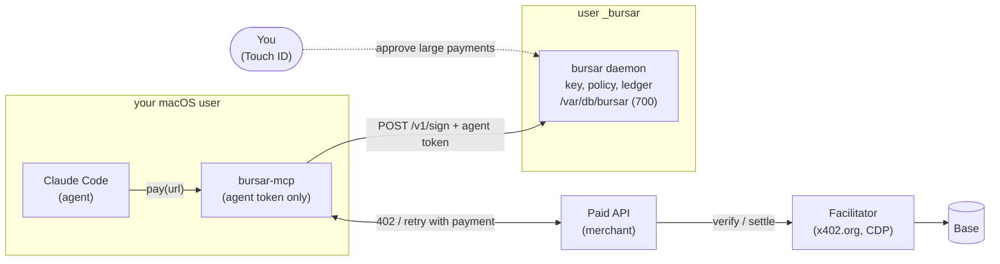

# bursar: safe setup and a first purchase by an agent

This guide takes you from nothing to Claude Code buying something with real USDC while you control every dollar. You run the whole thing on a testnet first (Base Sepolia, free money), then change a few lines and move to mainnet.

---

## 0. How it fits together



The core idea: **only whoever holds the key can spend the money, and only the `_bursar` process holds the key**. Claude Code runs as your user, so:

| The agent can             | The agent cannot                                                   |
| ------------------------- | ------------------------------------------------------------------ |
| ask bursar to pay         | read the key (`/var/db/bursar/key` is readable only by `_bursar`)  |
| check its own budget      | change the policy (the file belongs to root)                       |
| open a task with a budget | swap out bursar's code (`/opt/bursar` belongs to root)             |
|                           | approve a payment (that takes your Touch ID or your sudo password) |
|                           | stop or restart the daemon (it belongs to launchd and `_bursar`)   |

If the key sits in your home directory and the agent has a shell, every limit depends on the agent choosing to respect it. That is why the install below puts the key and the agent under different macOS users.

**What this does not protect.** bursar limits _how much and to whom_. The agent can still spend its allowance on things you did not need. That is the price of autonomy, so set limits you can afford to lose. bursar counts a payment when it signs it, not when the chain settles it.

---

## 1. What you need

- A Mac with Touch ID, and Chrome (for passkey approvals).
- Node 22.18+ (`node -v`).
- Admin rights on the Mac (for `sudo`).
- **A second address for the test merchant to receive payments.** Any EVM address you control, for example from Rabby or MetaMask. On the testnet you are paying yourself.

---

## 2. Check the code before installing

```sh
cd ~/dev/bursar
npm ci
npm test                 # 92 tests
npm run sandbox          # 18 scenarios with fake money, no network
```

If anything is red, stop here.

---

## 3. Install under a separate user

```sh
cd ~/dev/bursar
sudo NODE="$(command -v node)" PAY_TO=0xYOUR_SECOND_ADDRESS ./scripts/install-macos.sh
```

What the script does (read `scripts/install-macos.sh` before you run it, it is about 120 lines of sh):

| What                   | Where                                            | Owner and mode      | Why                                                          |
| ---------------------- | ------------------------------------------------ | ------------------- | ------------------------------------------------------------ |
| hidden user `_bursar`  | uid 450–499, no login, no shell                  |                     | the daemon runs as this user                                 |
| bursar code and `node` | `/opt/bursar`                                    | `root`, 755         | neither you nor the agent can modify it                      |
| **wallet key**         | `/var/db/bursar/key`                             | `_bursar`, 600      | only the daemon reads it                                     |
| policy                 | `/var/db/bursar/policy.yaml`                     | `root:_bursar`, 640 | the daemon reads it, only you change it, with `sudo`         |
| ledger, audit log, log | `/var/db/bursar/`                                | `_bursar`, 700      |                                                              |
| autostart              | `/Library/LaunchDaemons/dev.bursar.daemon.plist` | root                | starts the daemon at boot and restarts it if it crashes      |
| `bursar` command       | `/usr/local/bin/bursar`                          | root                | wrapper that runs `sudo -u _bursar` and adds the policy path |

At the end the script prints two things:

1. **The bursar wallet's EVM address.** This is where you put money.
2. **The agent token** for `claude-code`. It is shown once, and it is also stored in the policy. It is not a key: all it lets you do is ask bursar to sign within the policy.

The starting policy (`policy.testnet.example.yaml`) is strict on purpose:

| Limit                    | Value                        |
| ------------------------ | ---------------------------- |
| one payment              | ≤ $0.10                      |
| per day                  | ≤ $1.00                      |
| per month                | ≤ $5.00                      |
| rate                     | ≤ 10 payments per minute     |
| human approval (passkey) | above $0.05                  |
| chain and token          | Base Sepolia only, USDC only |
| recipient                | only your `PAY_TO`           |

### Check the isolation yourself

```sh
cat /var/db/bursar/key                         # Permission denied
ls /var/db/bursar                              # Permission denied
echo x >> /opt/bursar/app/src/index.ts         # Permission denied
launchctl print system/dev.bursar.daemon | grep state   # state = running
curl -s http://127.0.0.1:8402/v1/budget -H "Authorization: Bearer TOKEN" | jq .perDay
```

The first three commands must fail. The agent sees the system the same way you do without `sudo`.

---

## 4. Passkey: approvals with Touch ID

```sh
bursar passkey add --name "MacBook Touch ID"
```

The command asks for your sudo password and prints a one-time `http://localhost:…` link. Open it in Chrome and confirm with Touch ID. Check it worked:

```sh
bursar passkey list
```

From now on, every payment above the threshold waits until you open `http://localhost:8402/approve/apr_…`, read the amount and the recipient, and touch the sensor. In this mode you cannot approve from the CLI, by design. You can still deny: `bursar deny apr_…`.

---

## 5. Connect Claude Code

`bursar-mcp` is a small MCP server that Claude Code starts as your user. It holds no key, only the agent token. It does three things: `pay` (open a URL and, if it answers 402, pay through bursar), `budget` and `open_task`.

```sh
claude mcp add bursar --scope user \
  -e BURSAR_URL=http://127.0.0.1:8402 \
  -e BURSAR_TOKEN=TOKEN_FROM_STEP_3 \
  -- "$(command -v node)" ~/dev/bursar/src/mcp/server.ts
```

Restart Claude Code and run `/mcp`. You should see `bursar · connected` with three tools.

The token ends up in Claude Code's config, where the agent can read it. That is fine: the token grants exactly what the `pay` tool does and nothing more.

---

## 6. Test money

1. Get the bursar wallet address: `bursar address`.
2. Open [faucet.circle.com](https://faucet.circle.com), choose **Base Sepolia**, paste the address and request test USDC.
3. Check the balance on [sepolia.basescan.org](https://sepolia.basescan.org), under Token holdings.

You do not need ETH for gas. With x402 the facilitator sends the transaction and pays for it; bursar only signs an EIP-3009 authorization.

---

## 7. Test merchant

This is a real x402 server built on Coinbase's official `@x402/express` package. It talks to the real facilitator at `https://x402.org/facilitator`, so payments actually settle on Base Sepolia. The merchant's dependencies stay in its own directory and never reach bursar.

```sh
cd ~/dev/bursar/examples/testnet-merchant
npm ci
PAY_TO=0xYOUR_SECOND_ADDRESS npm start
```

| Endpoint    | Price | What should happen with the default policy |
| ----------- | ----- | ------------------------------------------ |
| `/joke`     | $0.01 | paid right away                            |
| `/report`   | $0.06 | above $0.05, so it waits for your Touch ID |
| `/gpu-hour` | $0.50 | denied with `per_tx_limit`                 |

Want to try it without the network first? `npm run offline` starts the same merchant with a local facilitator that checks the signature but sends nothing to the chain. It needs `0x5afe00000000000000000000000000000000cafe` as a recipient in the policy, so it is usually simpler to go straight to the testnet.

---

## 8. First purchase by the agent

In Claude Code, write something like:

> Buy a joke from http://127.0.0.1:4021/joke with the bursar pay tool and show me what you got.

What should happen:

1. Claude calls `pay`. The merchant answers 402. bursar checks the chain, token, recipient and limits, signs, and the merchant returns the joke.
2. The response includes `receipt.transaction`, the transaction hash. Look it up on sepolia.basescan.org: you should see a 0.01 USDC transfer from the bursar wallet to your second address.
3. `bursar report --period day` lists the payment.

Then check that the protections work:

| Tell the agent                                      | What should happen                                                                                                                                                                |
| --------------------------------------------------- | --------------------------------------------------------------------------------------------------------------------------------------------------------------------------------- |
| "Buy the report at http://127.0.0.1:4021/report"    | Claude gets `pending_approval` and a link. Open it, read the amount ($0.06) and the recipient, touch Touch ID and tell Claude "done". It calls `pay` again and the report is paid |
| "Buy a GPU hour at http://127.0.0.1:4021/gpu-hour"  | denied with `per_tx_limit`; Claude explains why and does not look for a way around it                                                                                             |
| "Open a $0.03 task and buy jokes until it runs out" | three jokes, then `task_budget_limit`                                                                                                                                             |
| "Pay some other x402 site"                          | `recipient_not_allowed` or `chain_not_allowed`: that recipient is not in the policy                                                                                               |

---

## 9. Moving to real money (Base mainnet)

Do this only after step 8 has fully passed on the testnet.

### 9.1. Find something to buy

Real x402 services (data, search, inference and so on) are listed in Coinbase's [Agentic.Market](https://www.coinbase.com/developer-platform/discover/launches/agentic-market) and in the [x402 Bazaar](https://docs.x402.org/extensions/bazaar). Pick one cheap service at $0.01–0.05 and see who it charges:

```sh
URL=https://service-address
curl -s -D - -o /dev/null "$URL" | awk -F': ' 'tolower($1)=="payment-required"{print $2}' | tr -d '\r' | base64 -d | jq '.accepts[] | {network, asset, payTo, amount}'
```

If there is no such header (older x402 v1), look at the body instead: `curl -s "$URL" | jq '.accepts[]'`. You want the option with `network: "eip155:8453"` (`"base"` in v1) and `asset: 0x833589fCD6eDb6E08f4c7C32D4f71b54bdA02913` (USDC on Base). The `payTo` in that answer is the address you add to the allowlist.

### 9.2. Change the policy

```sh
sudo nano /var/db/bursar/policy.yaml
```

```yaml
allow:
  chains: ['eip155:8453']
  assets:
    - {
        address: '0x833589fCD6eDb6E08f4c7C32D4f71b54bdA02913',
        chains: ['eip155:8453'],
        label: USDC on Base,
      }
  recipients:
    - {
        address: '0xSERVICE_PAYTO',
        label: service-name,
        chains: ['eip155:8453'],
      }
```

Leave the limits as they are for now. Apply the change:

```sh
sudo launchctl kickstart -k system/dev.bursar.daemon
bursar address          # also checks that the policy parses
```

### 9.3. Fund the wallet

Send **$5 of USDC on the Base network** to the address from `bursar address`, from an exchange or your own wallet. It has to be **Base**, not Ethereum. You do not need ETH.

### 9.4. Buy

> Use bursar pay to get the data from https://service-address/… and explain the result.

Then check three things:

- the transaction on [basescan.org](https://basescan.org);
- `bursar report`;
- that the balance dropped by exactly the price.

---

## 10. Everyday commands

Each of these asks for your sudo password on its own.

| What                               | Command                                                                                             |
| ---------------------------------- | --------------------------------------------------------------------------------------------------- |
| what is waiting for approval       | `bursar approvals`                                                                                  |
| deny                               | `bursar deny apr_…`                                                                                 |
| report                             | `bursar report --period day` (or `month`, `all`)                                                    |
| daemon log                         | `sudo tail -f /var/db/bursar/bursar.log`                                                            |
| is the daemon alive                | `launchctl print system/dev.bursar.daemon \| grep state`                                            |
| **emergency stop**                 | `sudo launchctl bootout system/dev.bursar.daemon`                                                   |
| start again                        | `sudo launchctl bootstrap system /Library/LaunchDaemons/dev.bursar.daemon.plist`                    |
| update the code after repo changes | run `sudo NODE="$(command -v node)" ./scripts/install-macos.sh` again (key and policy are kept)     |
| change the limits                  | `sudo nano /var/db/bursar/policy.yaml`, then `sudo launchctl kickstart -k system/dev.bursar.daemon` |

After an emergency stop, no new payment gets signed. Signatures already handed out stay valid until their `validBefore`, which is a few minutes.

### Getting the money out of the bursar wallet

bursar deliberately has no "send everything to X" command. The emergency exit is this: `sudo cat /var/db/bursar/key` prints a line `evm: 0x…`. Import that private key into Rabby or MetaMask and move the USDC wherever you want. From then on treat the key as compromised: create a new one (`sudo rm /var/db/bursar/key`, then run the installer again) and never fund the old address again.

---

## 11. The rules that hold all of this together

1. **Never let Claude Code run `sudo`.** Do not set up passwordless sudo, and do not run `sudo` through the agent. If your sudo uses Touch ID, treat every unexpected Touch ID prompt as an alarm, not a formality.
2. **Approve only payments you expect.** On the approval page, read the amount and the recipient _before_ you touch the sensor. If an agent or a website opened an approval page you did not ask for, press Deny.
3. **The key lives only in `/var/db/bursar`.** Do not copy it into the repo, a `.env` file or a chat.
4. **Limits = an amount you can afford to lose.** Raise them gradually, and only after reading `bursar report` for a few days.
5. **Add a new recipient only after checking it.** The allowlist is the main defence against prompt injection like "pay here instead". Add only addresses taken from the 402 response of a service you chose yourself.
6. **Keep little on the wallet.** Top it up for a week, not for a year.

---

## 12. Uninstall

```sh
sudo ./scripts/uninstall-macos.sh           # stops the daemon, removes the code, keeps key and history
sudo ./scripts/uninstall-macos.sh --purge   # also deletes the key; move the funds out first
claude mcp remove bursar --scope user
```
